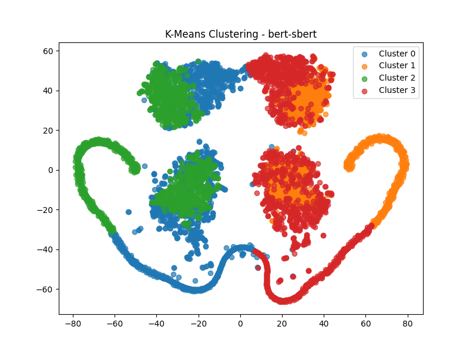

# Newspaper Article Embeddings: Clustering and Classification

Comparing classic and neural text representations (TF-IDF, Word2Vec, Doc2Vec, BERT, SBERT) on news articles from four newspapers, then clustering the documents and training classifiers to predict which newspaper wrote each article.



> Academic project, Information Retrieval course, Jerusalem College of Technology (2024).

## Pipeline

```
raw articles (A-J, BBC, J-P, NY-T)
   │
   ▼
Part 1: text representations
   • cleaning + lemmatization (spaCy)
   • TF-IDF matrices for cleaned and lemmatized text
   • Word2Vec and Doc2Vec (Gensim), BERT and SBERT (Hugging Face)
   • feature ranking with Information Gain and Chi-squared
   │
   ▼
Part 2: unsupervised + supervised analysis
   • PCA to 50 dimensions, then K-Means, DBSCAN and Gaussian Mixture clustering
   • t-SNE visualizations of the clusters
   • classifiers: Naive Bayes, Logistic Regression, linear SVM, Random Forest (10-fold CV)
   • a feed-forward neural network (ReLU vs. GELU) with early stopping
```

## Results

Predicting the source newspaper (4 classes, chance = 25%) with the neural classifier, approximate validation accuracy read from the training curves in [`results/ann_training`](results/ann_training):

| Representation | Validation accuracy |
|---|---|
| BERT (with IDF weighting) | ~97% |
| SBERT | ~72% |

Contextual BERT embeddings separated the newspapers far better than sentence-level SBERT vectors. Cluster visualizations for each representation and clustering method are in [`results/clustering`](results/clustering).

## Repository structure

```
part1_representations/
  partA/            text cleaning and lemmatization
  tfidf/            TF-IDF matrices
  W2V/  doc2vec/    Word2Vec and Doc2Vec document vectors
  bert/  sbert/     transformer embeddings
  feature_metrics/  Information Gain, Chi-squared, top-20 terms
part2_clustering_classification/
  clustering.py                  K-Means, DBSCAN, GMM + t-SNE plots
  bert_sbert_classification.py   classifiers + ANN on BERT/SBERT vectors
  classification_models.py       classical models + ANN across representations
results/
  clustering/  ann_training/
```

The raw article dataset was provided by the course and is not included. The generated embedding files (several hundred MB) are not included either; running Part 1 recreates them.

## Tech stack

Python · scikit-learn · TensorFlow/Keras · Gensim · Hugging Face Transformers · Sentence-Transformers · spaCy · pandas

## Authors

Ori Shoshana and Amir Hai Tamar
